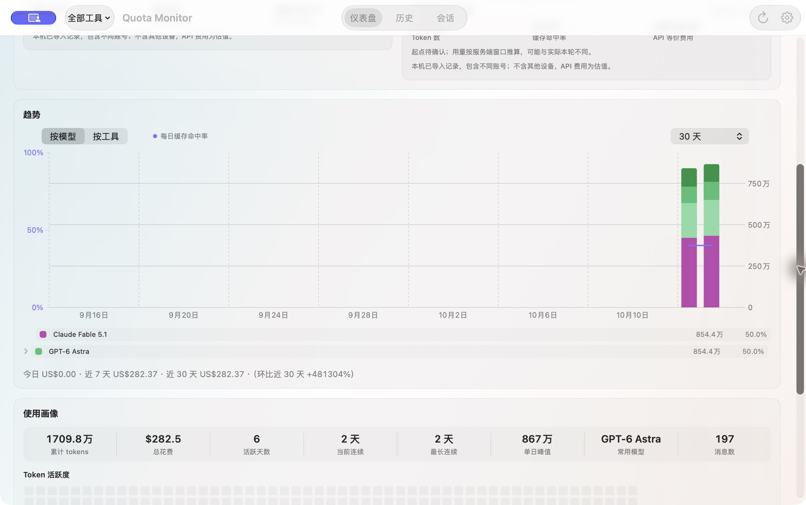
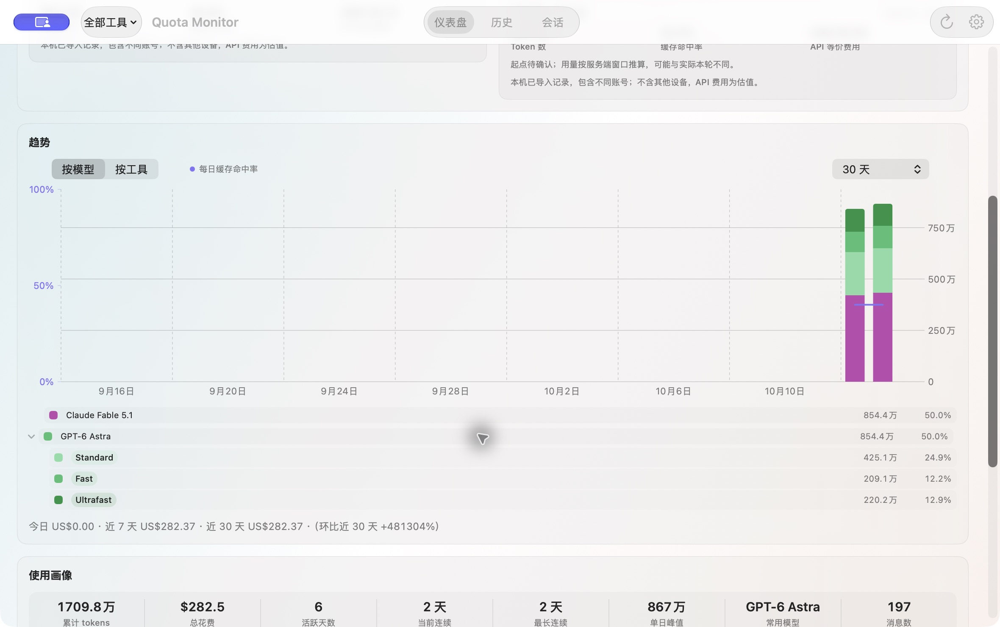
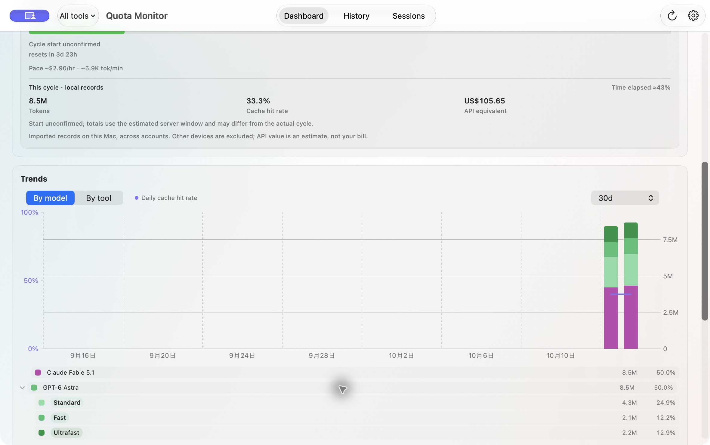

# Model legend verification

Captured from isolated fixture builds at source commit `4b5879df50da344cb85097aaa17f04e5f2d8192a` (1.0.13, QA build 10000139000). Screenshots contain synthetic data only.

Verified in Chinese and English: models start collapsed, expanding GPT-6 Astra shows Standard/Fast/Ultrafast, and collapsing hides all children. The Chinese fixture parent has 8,544,000 tokens; children have 4,251,000 + 2,091,000 + 2,202,000 tokens. Shares use the same displayed-period denominator. Provider grouping remains flat, and switching to 7 days retains the collapsed model total.

Keyboard-only disclosure navigation was not verified: Tab did not move focus under this machine's current keyboard settings. The control uses SwiftUI's native DisclosureGroup. No system settings were changed.

Local static gate: 217 Python/tool tests and 1116 Swift tests in 128 suites passed.

| Default | Expanded |
| --- | --- |
|  |  |

