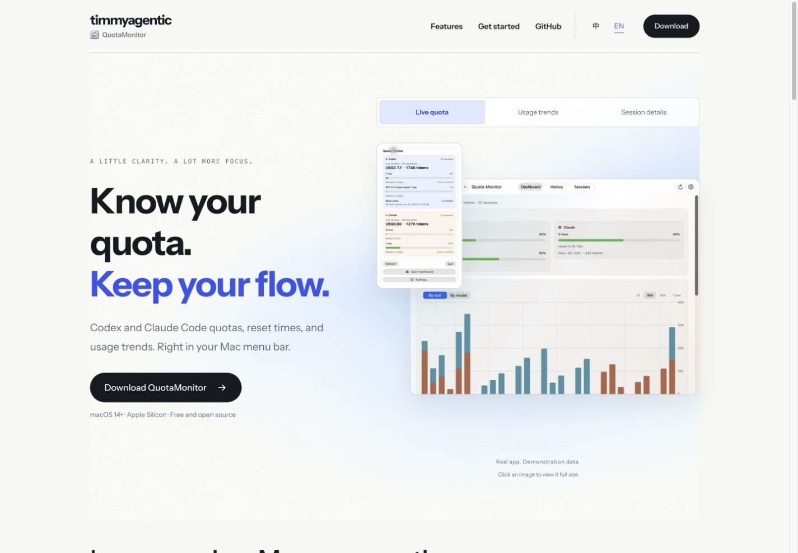
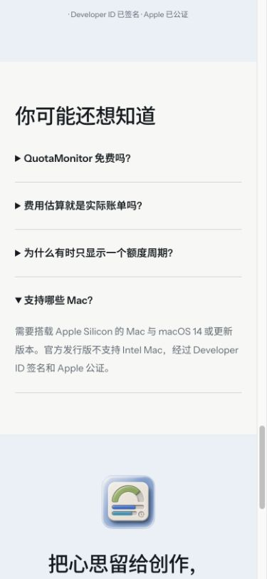

# Website polish QA — 2026-10-25

The English and Chinese compatibility text now states Apple Silicon and excludes Intel releases. Switching all three preview tabs preserves the layout; inactive panels remain absent from the accessibility tree.

Validated in a local browser at 1440 × 1000 and 390 × 844; the page also has no horizontal overflow at 320 px. Visible images loaded. Social metadata resolves to a 1200 × 630 image. Screenshots below are unmodified browser captures of the candidate.

Checks passed: `./qa/run-static.sh` and `npm --prefix website run check`.

At 1440 px, all three English previews kept the heading at 326.02 px. At 390 px, all three Chinese previews kept the heading at 177 px and the next section at 1032.09 px. Keyboard arrow navigation and the active panel focus were checked.

This is website acceptance. Live installation, authentication, production hardware/network operations, and native client acceptance are outside this change. A successful local check does not prove production deployment; the reviewed commit must be deployed and read back separately.

